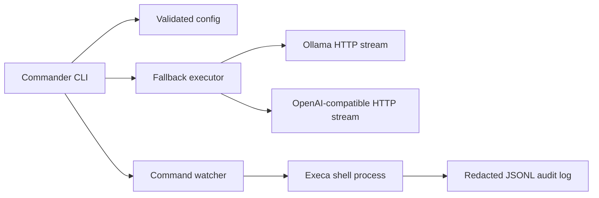

# cli-agent-bridge

[](#development)
[](https://www.npmjs.com/package/cli-agent-bridge)
[](LICENSE)

A terminal-first LLM gateway for Node.js 20+. It sends prompts to local Ollama by default, switches to an OpenAI-compatible cloud endpoint when a recoverable provider error occurs, and records watched shell activity as redacted JSONL.

> **Status:** v0.1.0 is under active development. The package is ready to install from a checkout; npm installation will be available after its first release.

## Install

```sh
npm ci
npm run build
npm link
```

After the package is published, install it globally with `npm install --global cli-agent-bridge`.

## Quickstart

Install and start [Ollama](https://ollama.com/), then pull the default model:

```sh
ollama pull llama3.2
cli-agent-bridge exec "Explain what a Unix pipe does in one sentence."
```

Ollama is the default primary provider at `http://localhost:11434`. If it is unreachable, times out, returns a server error, or rejects an oversized context, the CLI reports the switch and tries OpenAI. Set `OPENAI_API_KEY` to enable cloud requests. Authentication failures do not trigger fallback.

## Commands

### `exec [prompt]`

```text
cli-agent-bridge exec [options] [prompt]
```

Runs a prompt against the configured primary provider. If no prompt argument is given and stdin is piped, stdin supplies the prompt. Responses stream to stdout by default; status and fallback notices go to stderr. Spinners appear only when both output streams are terminals and `NO_COLOR` is not set.

| Option                       | Description                                                                                                                                                                                |
| ---------------------------- | ------------------------------------------------------------------------------------------------------------------------------------------------------------------------------------------ |
| `--fallback`                 | Start with OpenAI, then use the configured primary if OpenAI fails recoverably. This is cloud-first mode; automatic fallback from the normal primary is enabled by default through config. |
| `--primary <ollama\|openai>` | Select the primary provider for this request.                                                                                                                                              |
| `--model <model>`            | Override the selected provider's model for this request.                                                                                                                                   |
| `--timeout <seconds>`        | Override request timeout; must be positive.                                                                                                                                                |
| `--json`                     | Buffer the response and write JSON containing response text and provider metadata.                                                                                                         |
| `--no-stream`                | Buffer the response before writing it to stdout.                                                                                                                                           |
| `-h, --help`                 | Show command help.                                                                                                                                                                         |

Provider errors are classified as `context_overflow`, `connection_refused`, `timeout`, `rate_limited`, `auth`, `server_error`, or `unknown`. Context overflow, connection refusal, timeout, and server errors may switch providers. Rate limits are retried with backoff before being returned. Authentication failures never switch providers. If a provider fails after emitting text, stderr says that the switch happened after partial output.

### `config`

```text
cli-agent-bridge config <set|get|list|path|reset|init>
```

| Subcommand          | Description                                                                       |
| ------------------- | --------------------------------------------------------------------------------- |
| `set <key> <value>` | Validate and persist one setting.                                                 |
| `get <key>`         | Print one effective setting; API keys are masked.                                 |
| `list`              | Print effective settings as JSON with API keys masked.                            |
| `path`              | Print the persistent config file path.                                            |
| `reset`             | Remove the persistent config file.                                                |
| `init`              | Interactively configure the providers and fallback settings. Requires a terminal. |

Valid keys are `primary`, `fallback`, `ollamaBaseUrl`, `ollamaModel`, `openaiBaseUrl`, `openaiModel`, `openaiApiKey`, `timeoutSeconds`, `rateLimitRetries`, `logPath`, and `maxLogBytes`. Storing `openaiApiKey` in the config file is supported but emits a warning; prefer an environment variable. The file is written with mode `0600`.

### `watch`

```text
cli-agent-bridge watch [options]
```

| Option              | Description                                                                                                                    |
| ------------------- | ------------------------------------------------------------------------------------------------------------------------------ |
| `--cmd <command>`   | Shell command to run. With no `--paths`, it runs once.                                                                         |
| `--paths <glob...>` | Watch one or more globs, run once initially, then debounce and rerun on changes. Defaults to `npm test` if `--cmd` is omitted. |
| `--log <file>`      | Override the JSONL audit log path.                                                                                             |
| `-h, --help`        | Show command help.                                                                                                             |

Both modes tee command stdout and stderr to the terminal. Each run appends an audit entry containing timestamp, working directory, command, exit code, duration, trigger, error summary, capped stderr tail, and redacted environment. The default log is `.agent-bridge.log`; it rotates to `.agent-bridge.log.1` when the configured size limit is exceeded. Credential-like values are redacted before logging.

## Examples

Ask a local model and keep the response stream pipe-safe:

```sh
cli-agent-bridge exec "Summarize this diff in three bullets."
git diff | cli-agent-bridge exec "Review this patch for bugs"
```

Use OpenAI first for a larger model, with the configured primary as the alternate:

```sh
OPENAI_API_KEY=... cli-agent-bridge exec --fallback --model gpt-4o-mini "Explain this stack trace"
```

Set up a local endpoint and use a compatible cloud endpoint:

```sh
cli-agent-bridge config set ollamaModel qwen2.5-coder
cli-agent-bridge config set openaiBaseUrl https://api.openai.com/v1
cli-agent-bridge config set openaiModel gpt-4o-mini
export OPENAI_API_KEY=...
```

Run tests when source files change and send the audit log elsewhere:

```sh
cli-agent-bridge watch --cmd "npm test" --paths "src/**" "tests/**" --log .logs/agent-bridge.jsonl
```

## Configuration

Configuration is merged in increasing priority, so later sources override earlier ones:

1. Built-in defaults
2. `~/.config/agent-bridge/config.json`
3. `.env` in the current working directory
4. Environment variables
5. CLI flags for the current command

| Setting            | Environment variable(s)                         | Default                     |
| ------------------ | ----------------------------------------------- | --------------------------- |
| `primary`          | `AGENT_BRIDGE_PRIMARY`                          | `ollama`                    |
| `fallback`         | `AGENT_BRIDGE_FALLBACK`                         | `true`                      |
| `ollamaBaseUrl`    | `AGENT_BRIDGE_OLLAMA_BASE_URL`                  | `http://localhost:11434`    |
| `ollamaModel`      | `AGENT_BRIDGE_OLLAMA_MODEL`                     | `llama3.2`                  |
| `openaiBaseUrl`    | `AGENT_BRIDGE_OPENAI_BASE_URL`                  | `https://api.openai.com/v1` |
| `openaiModel`      | `AGENT_BRIDGE_OPENAI_MODEL`                     | `gpt-4o-mini`               |
| `openaiApiKey`     | `OPENAI_API_KEY`, `AGENT_BRIDGE_OPENAI_API_KEY` | unset                       |
| `timeoutSeconds`   | `AGENT_BRIDGE_TIMEOUT`                          | `120`                       |
| `rateLimitRetries` | `AGENT_BRIDGE_RATE_LIMIT_RETRIES`               | `2`                         |
| `logPath`          | `AGENT_BRIDGE_LOG`                              | `.agent-bridge.log`         |
| `maxLogBytes`      | `AGENT_BRIDGE_MAX_LOG_BYTES`                    | `5000000`                   |

The config file is stored at `~/.config/agent-bridge/config.json`. Keep API keys in the environment when possible. If a key is persisted, `config get` and `config list` mask all but its final four characters.

## Architecture



The provider interface uses native `fetch` and async text streams. The executor owns timeout, retry, interruption, and fallback decisions. Watch mode uses chokidar for path events and execa for shell processes; no provider SDK is installed.

## Troubleshooting

- **Ollama connection refused:** make sure `ollama serve` is running and `AGENT_BRIDGE_OLLAMA_BASE_URL` points to the Ollama server.
- **Model not found:** run `ollama pull llama3.2` or set `AGENT_BRIDGE_OLLAMA_MODEL` to an installed model.
- **OpenAI auth failure:** set `OPENAI_API_KEY`; auth errors intentionally stop instead of switching providers.
- **No fallback:** automatic fallback is on by default for connection, timeout, context, and server errors. Check `cli-agent-bridge config get fallback` and confirm an OpenAI-compatible endpoint and key are configured.
- **No spinner:** spinners are disabled for piped output and when `NO_COLOR` is set. This keeps stdout suitable for shell pipelines.
- **Watch command does not repeat:** provide `--paths`; `--cmd` by itself runs one time.
- **Audit log is large:** set `AGENT_BRIDGE_MAX_LOG_BYTES` or use `--log` to choose its location. One previous log generation is kept with the `.1` suffix.

## Development

```sh
npm ci
npm run lint
npm run typecheck
npm run test
npm run build
```

See [CONTRIBUTING.md](CONTRIBUTING.md) for contribution expectations. CI runs these checks on Node 20 and 22.

## Roadmap

- v0.1: local Ollama primary, one OpenAI-compatible fallback, command watch mode, and redacted JSONL audit logging.
- Follow-up: publish the first npm release and improve provider diagnostics based on user feedback.
- Out of scope for v0.1: GUI, telemetry, multi-provider chains, tool calling, and autonomous agent loops.

## License

MIT. See [LICENSE](LICENSE).
